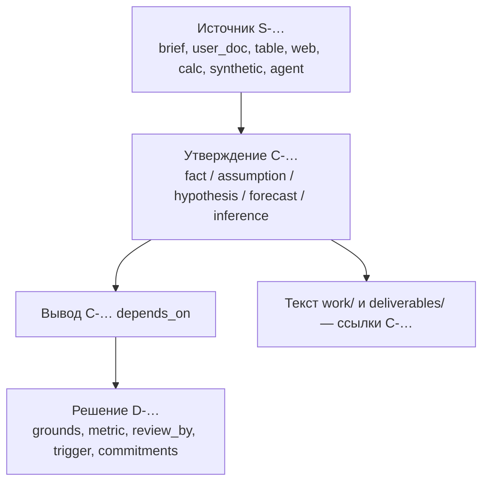

# Архитектура агента

## 1. Идея в одном абзаце

Агент — это LLM в среде разработки (Claude Code, Cursor, Codex, OpenCode) плюс папка, которая задаёт ему **процесс**,
**правила доказательности**, **методики** и **инструменты**. Модель сама выбирает следующий шаг и проверяет результат.
Состояние задачи и все основания выводов хранятся в файлах проекта, а не в контексте модели. Поэтому работу можно
остановить, продолжить в новом чате или другой среде, а любой вывод проследить до источника.

## 2. Слои знаний (разделены физически)

| Слой | Где | Кто меняет | Правило |
|---|---|---|---|
| Постоянные инструкции | `AGENTS.md`, `.claude/agents/`, `.claude/skills/`, `.cursor/rules/` | команда разработки | Текст из источников их не меняет |
| Методические знания | `knowledge/*.md` (14 методик) | команда разработки | «Как делать», без фактов о конкретном рынке |
| Материалы проекта | `projects/<id>/sources/` + `sources.jsonl` | агент через `sfp source add` | Каждый файл зарегистрирован, с хэшем; изменение файла ловит `sfp check` |
| Состояние задачи | `state.json`, `claims.jsonl`, `decisions.jsonl`, `log.jsonl` | только `tools/sfp.py` (CLI или MCP) | Нельзя править руками: проверки и журнал |
| Рабочие продукты | `work/NN_*.md`, `deliverables/`, `calc/` | агент | Ссылки `[C-…]`, `[S-…]`, `[D-…]` на реестры |

## 3. Рабочий процесс

```mermaid
flowchart LR
  A[01 Постановка] -->|человек подтверждает| B[02 Материалы]
  B --> C[03 Исследование]
  C --> D[04 Картина ситуации]
  D --> E[05 Варианты + red-team]
  E -->|человек выбирает| F[06 Выбор]
  F --> G[07 Продукт + коммуникация]
  G --> H[08 План проверки]
  H --> I[09 План по кварталам]
  I --> J[10 Итоговый документ + red-team + evaluator]
  J -->|человек принимает| K[11 Решения и пересмотр]
  K -. новые данные .-> C
  H -. найдена ошибка .-> G
```

- Каждый шаг описан навыком `.claude/skills/<шаг>/SKILL.md`: что сделать, какие методики прочитать, рубрика качества.
- `sfp stage <id> in_progress|done|waiting_human|revisit` двигает процесс. `waiting_human` — контрольная точка:
  агент показывает резюме и варианты и **останавливается**.
- Возврат назад (`revisit`) разрешён и пишется в журнал. В демо шаг 09 нашёл, что разработчики есть только во втором
  квартале, и сдвинул даты шагов 07–08.

## 4. Реестры и доказательность

Правила, которые проверяет `sfp check` (ошибка блокирует сдачу):
- `fact` нужен внешний источник. Ответ агента (`agent`) и синтетика (`synthetic`) фактом быть не могут.
- Синтетика порождает только `hypothesis`.
- `assumption` обязан иметь способ проверки, `inference` — основания, `forecast` — диапазон (иначе предупреждение).
- Ссылки в текстах ведут на существующие и **активные** записи. Ссылка на заменённую запись — предупреждение с
  указанием файла.
- Решение с устаревшим основанием, наступившим сроком пересмотра или просроченным обязательством — предупреждение.
- Файл источника изменился после регистрации — предупреждение и `sfp impact S-…`.

Пересмотр: `claim supersede` (уточнено) или `claim retract` (было неверно) сразу показывает затронутые выводы,
решения и документы. Старые записи не удаляются: история видна.

## 5. Модели, субагенты, маршрутизация

Главный агент работает на сильной модели. Узкие задачи уходят субагентам с моделью «по задаче»
(`tools/routing.json`, `sfp route "<задача>"`):

| Субагент | Модель | Задача | Почему так |
|---|---|---|---|
| `evaluator` | haiku | оценка по рубрике, классификация, кодирование | выбор из заданных признаков; дёшево и повторяемо |
| `synthetic-respondent` | haiku | модельные интервью | гипотезы, а не доказательства — дорогая модель не нужна |
| `researcher` | sonnet | чтение и сопоставление многих материалов | не засоряет контекст главного агента |
| `analyst` | sonnet | расчёты кодом, проверка единиц и знаменателей | число считает Python |
| `ux-reviewer` | sonnet | разбор экранов с привязкой к видимому | мультимодальность |
| `red-team` | opus | сильнейшие возражения; не видит рекомендацию | качество суждения решает |

**Исправление ошибочного выбора:** если оценка `evaluator` ниже порога 0,75, шаг переделывается моделью
следующей ступени (`haiku → sonnet → opus`), и это пишется в журнал. В демо все оценки выше порога (0,83–0,975).
Зато red-team дважды заставил исправить расчёт и стратегию (шаги 05 и 10).

## 6. Хуки (Claude Code)

| Событие | Хук | Что делает |
|---|---|---|
| SessionStart | `tools/hooks/session_start.py` | печатает состояние проекта, следующее действие и итог `sfp check` — новый чат сразу знает, где остановились |
| PreToolUse (WebFetch, WebSearch, Write, Edit) | `tools/hooks/guard.py` | блокирует домены вне `allowed_domains` и прямую правку реестров (`*.jsonl`, `state.json`) в обход `sfp`; чтение `.env` запрещено правами в `settings.json` |
| PostToolUse (все) | `tools/hooks/log_tool.py` | строка в `log.jsonl` на каждое действие; ошибки помечаются, чтобы после сбоя не повторить сделанное незаметно |

## 7. Интеграции: CLI и MCP

- **CLI** `tools/sfp.py` (`./sfp`): `init`, `status`, `stage`, `source`, `claim`, `impact`, `decision`, `check`, `log`,
  `cost`, `history`, `search`, `route`, `export`. Работает без модели, поэтому его же используют тесты и человек.
- **MCP-сервер** `tools/mcp_server.py` (stdio, без зависимостей): `sfp_status`, `sfp_claims`, `sfp_add_claim`,
  `sfp_search`, `sfp_impact`, `sfp_decisions`, `sfp_check`, `sfp_route`. Те же реестры доступны средам, где удобнее
  MCP, чем shell.
- **Извлечение:** `tools/extract.py` (PDF, DOCX, XLSX, CSV, HTML → Markdown, только стандартная библиотека,
  PDF — `pdftotext` или `pypdf`). `tools/fetch_source.py` — снимок страницы с разрешённого домена.
  Оба помечают в тексте «инструкции для ИИ».
- **Расчёты:** `tools/calc/economics.py` (помесячная модель удержания → ВП, граница решения, окупаемость,
  предельные вложения), `forecast.py` (5 показателей брифа), `sample_size.py` (выборка, эффект дизайна, темп набора).
  Параметры — в `projects/<id>/calc/params*.json` с типом и ссылкой на утверждение.

## 8. Контекст и память

- В контекст модели попадает только нужное. Методику читает навык шага, большие материалы читают субагенты
  и возвращают выжимку со ссылками.
- `sfp search "<формулировка>"` ищет по знаниям, рабочим файлам и реестрам. Ранжирование — TF-IDF по символьным
  n-граммам: находит разные словоформы, например «перебой» и «перебоев». Точное совпадение слова даёт бонус.
  К каждому найденному фрагменту выводятся его связи (`C-…`, `S-…`). Без векторной БД и внешних зависимостей;
  синонимы и смысловую близость не ловит.
- Память между сессиями — это реестры и журнал. Они хранят, **что** агент утверждал и **на чём** это основано,
  но не делают прежний ответ истиной: у ответа агента тип источника `agent`, и `sfp check` не даст сделать из него `fact`.

## 9. Устойчивость и переносимость

- Состояние пишется после каждого действия. При старте агент читает `sfp status` и `sfp history -n 15`,
  чтобы не повторять сделанное.
- Ошибки инструментов попадают в журнал с пометкой. Защитный отказ (например, хук или проверка безопасности)
  агент не обходит и сообщает человеку.
- Проект — это файлы и Git. Чтобы продолжить в другой среде, достаточно открыть папку: `AGENTS.md` читают все среды,
  `sfp` работает на любом Python 3.11+.
