# Как мы делали «Деканат Next» вместе с ИИ

> Описание процесса для жюри конкурса «Цифровой деканат будущего». Концепт, не официальный сервис вуза, все данные вымышлены.
>
> **Прототип:** https://dnastuhan-hash.github.io/mgimochallenge/ · **Код:** https://github.com/dnastuhan-hash/mgimochallenge/tree/main/Вайб-кодинг · **Скриншоты:** [раздел 7](#7-скриншоты)

## 1. Какую проблему решаем

Учебная жизнь студента разбросана по разным местам. Из открытых исследований (подробно — `docs/RESEARCH.md`):
- сайтом и личным кабинетом вуза пользуются **97%** студентов, но **NPS всего 10%**, то есть пользуются, потому что приходится (6 820 студентов, 48 вузов, 2026);
- на UX-тесте **половина новичков не нашла** раздел «Заказ справки». Расписание — самый частый сценарий, и студенты пишут для него неофициальные приложения;
- **74%** удобнее получать изменения расписания уведомлением. Главный источник новостей — староста (28%), а не официальные каналы;
- у многих кабинетов нет мобильной версии, хотя основной трафик идёт с телефонов;
- большинство студентов не знают и половины функций своего кабинета.

**Отсюда три принципа «Деканата Next»:**
1. **Главная сама говорит, что важно сейчас**: следующая пара, «горящий» тест, перенос, готовая справка.
2. **Кабинет подстраивается под студента**: лишнее скрыто, нужное закреплено. Платнику не нужна стипендия, кому-то хватит расписания и оценок.
3. **Всё за 1–2 касания и с телефона.**

Собственный опрос в сроки конкурса мы не проводили: решения опираются на открытые исследования выше. Анкета, чтобы проверить гипотезы на студентах своего вуза, лежит в `docs/RESEARCH.md`, раздел 7.

## 2. ИИ-инструменты и для чего каждый

| Инструмент | Для чего |
|---|---|
| **Claude Code** (desktop-приложение, модель Claude Opus) | основной ИИ-разработчик: исследование, продуктовые решения, архитектура, весь код сервера и интерфейса, автотесты, документация |
| **Субагенты Claude Code** (web-fetch) | параллельно читали первоисточники (Хабр, CyberLeninka, Univermark) и возвращали выжимку, чтобы не засорять основной контекст |
| **Веб-поиск Claude Code** | поиск опросов и исследований о личных кабинетах студентов (РФ и мир) |
| **Встроенный браузер Claude Code** | ИИ сам открывал прототип на ширине 360 px, проходил сценарии, делал скриншоты, находил и исправлял баги вёрстки |
| **Chrome без окна + DevTools Protocol** | ИИ написал скрипт, который проходит сценарии демо на 360 px от лица студентов и сотрудника и сохраняет скриншоты из раздела 7 |
| **CLAUDE.md** | «конституция» проекта для ИИ-агентов: правила безопасности, вымышленные данные, mobile-first |

Иконки и логотип ИИ нарисовал в SVG. Сторонних картинок, шрифтов и генераторов изображений нет.

## 3. Этапы и ключевые промпты

### Этап 0. Постановка задачи
Капитан вставил в Claude Code полный текст ТЗ конкурса.

### Этап 1. Исследование до кода
> **Промпт:** «Сначала собери все данные (опросы, тесты и т.д.) на эту тему, для того чтобы лучше понимать, какое именно приложение нужно сделать и какие должны быть функции.»

ИИ сделал 7 веб-поисков и запустил 3 субагента, которые прочитали первоисточники. Результат — `docs/RESEARCH.md`: 12 источников, выводы и требования к продукту.

### Этап 2. Продуктовые решения команды (диалог с ИИ)
> **Промпт:** «Нужно сделать, чтобы в мобильном приложении можно было через настройки скрывать и показывать разделы, чтобы не было загромождения информации. К примеру, платникам не нужен раздел стипендий, кому-то может понадобиться карта вуза, кто-то захочет читать новости, а кто-то вообще не будет пользоваться ничем, кроме расписания и оценок.»

ИИ спроектировал модульный кабинет: пресеты, настройки по профилю, закрепление в меню, «скрытое не теряется», важные уведомления приходят всегда.

> **Промпт:** «Также важно, чтобы была возможность выгружать расписание в Google или Яндекс Календарь (впоследствии, если появится какой-то другой популярный аналог, и туда тоже).»

ИИ предложил открытый стандарт iCalendar с подпиской: один формат для всех календарей, а новый календарь добавляется одной строкой конфига.

> **Промпт:** «Если в вузе есть СДО, где преподаватели размещают тесты для прохождения вне пары, было бы неплохо иметь уведомления о начале и конце сдачи, а ещё лучше раздел, где отображаются открытые тесты со ссылками.»

> **Промпт-уточнение:** «Нет, сроки сдачи лучше не добавлять в календарь.»

Команда отклонила предложение ИИ выгружать дедлайны в календарь. ИИ убрал это из спецификации, кода и записал как правило в `CLAUDE.md`.

### Этап 3. Сборка
> **Промпт:** «Да, собирай.»

Перед кодом ИИ выбрал стек и объяснил выбор:
- **Node.js без фреймворков + встроенный SQLite**: ноль внешних зависимостей на сервере, легко развернуть на любом хостинге;
- **SPA на чистом JS без сборки**: быстро грузится на телефоне;
- масштабирование: сервер без состояния, SQLite заменяется на PostgreSQL.

Порядок работы: схема БД и вымышленные данные → API с проверкой владельца на каждом запросе → дизайн-система (токены, светлая и тёмная темы) → каркас и персонализация → страницы → кабинет сотрудника.

### Этап 4. Проверка ИИ самим собой
ИИ запускал сервер, проверял API через curl, затем открывал кабинет во встроенном браузере на **360×780** и проходил сценарии: вход → онбординг → главная → заказ справки → чужая заявка (404) → смена статуса сотрудником → уведомление у студента. Дальше он написал **автотесты безопасности** (`npm test`, сейчас их 10).

### Этап 5. Бесплатная ссылка для жюри
> **Промпт:** «Мне нужен бесплатный вариант. Желательно без хостинга.»

ИИ предложил три варианта с честными плюсами и минусами, команда выбрала GitHub Pages. Чтобы не писать второй сервер, ИИ вынес маршруты API в платформенно-независимый модуль `server/routes.js`. В Node.js его запускает `server/index.js`, в браузере — `demo/browser-server.js` поверх SQLite в WebAssembly (sql.js). Перед публикацией ИИ проверил демо на адресе с подпапкой, как у GitHub Pages, и прогнал автотесты сервера.

Демо: https://dnastuhan-hash.github.io/mgimochallenge/

### Этап 6. Скриншоты и вычитка
> **Промпт:** «Сделай скриншоты и доведи описание процесса до чистовика.»

ИИ прошёл сценарии на 360 px и снял 16 экранов. На снимке главной он заметил, что заголовок «Сегодня пар нет» стоит над списком пар на завтра, и сам исправил его на «Ближайшие пары».

## 4. Ошибки ИИ и как их исправили (честно)

| Что пошло не так | Как нашли | Как исправили |
|---|---|---|
| На 360 px главная «уезжала» вправо: элементы grid по умолчанию не сжимаются | скриншот в браузере и замер `scrollWidth` | `min-width: 0` для элементов сеток; правило записано в `CLAUDE.md` |
| Контент выглядел «полупрозрачным»: анимация появления зависала в фоновой вкладке | скриншоты | убрали анимацию появления страниц |
| Браузер держал старый CSS из кэша, исправления «не применялись» | бейдж «0» не скрывался | статика отдаётся с `Cache-Control: no-cache` |
| Иконка ошибки на входе была видна всегда: `display:flex` перебивал атрибут `hidden` | скриншот | глобальное правило `[hidden]{display:none!important}` |
| В выходные расписание открывалось на пустом дне | проверка в субботу | в выходные сразу показывается следующая неделя |
| Кириллица в UID событий календаря могла ломать некоторые календари | ревью ICS-файла | ASCII-идентификаторы событий |
| Автозамена через sed потеряла экранирование точки в регулярке | повторная проверка кода | исправлено вручную |
| ИИ попытался завершить все процессы Node на компьютере, и защита Claude Code это заблокировала | блокировка с объяснением | остановили только свой тестовый сервер по номеру порта |
| После выноса маршрутов в общий модуль ответ главной (в нём есть поле «session» — сессия экзаменов) ошибочно принимался за новый токен входа, и студента «выкидывало» | проверка демо в браузере: ответ 401 и токен «[object Object]» | служебное поле переименовано в `setSession`, добавлен регрессионный автотест |
| ИИ передал тексты с обратными кавычками через bash, и оболочка выполнила их как команды — документация испортилась | вывод команды с ошибками «command not found» | изменения откатили через git и внесли заново через файл-скрипт |
| В выходной день главная писала «Сегодня пар нет» прямо над списком пар на понедельник | вычитка финальных скриншотов | заголовок «Ближайшие пары · дата» |
| На Windows файл БД остаётся занятым после теста | падение `npm test` при очистке | безопасная очистка временной папки |

## 5. Как устроены вход, данные и защита (простыми словами)

- **Пароль** нигде не хранится. Хранится его «отпечаток» (scrypt с солью), по которому пароль нельзя восстановить.
- **После входа** браузер получает пропуск — случайный токен в защищённом cookie. JavaScript страницы его прочитать не может, а в базе лежит только отпечаток токена.
- **Каждый запрос** сервер выполняет от имени владельца пропуска. Номер заявки из адреса используется только вместе с условием «и она принадлежит этому студенту». Чужая заявка выглядит как несуществующая.
- **Роли**: студент не может вызвать функции сотрудника, сотрудник не видит студенческие разделы.
- **Ссылка на календарь** — отдельный секретный ключ, открывающий только расписание. Её можно сбросить.
- **QR студбилета** подписан секретом сервера и живёт 5 минут.
- **Ключи и секреты** берутся из переменных окружения или файла на сервере. В коде и браузере их нет.
- **Данные** все вымышленные. Кабинет нигде не подключается к реальным системам вуза.

## 6. Что сделано вручную
- Сформулированы продуктовые требования (модульность, календарь, СДО, отказ от дедлайнов в календаре).
- Проверка результата и принятие решений по предложениям ИИ.
- Выбор способа публикации: бесплатно и без хостинга, через GitHub Pages. Доступ ИИ к репозиторию, настройка основной ветки.
- Ручная проверка демо по ссылке и отправка работы.

## 7. Скриншоты

Сняты с демо-версии на ширине **360 px** (телефон). Все данные вымышлены.

**Вход и настройка под себя**

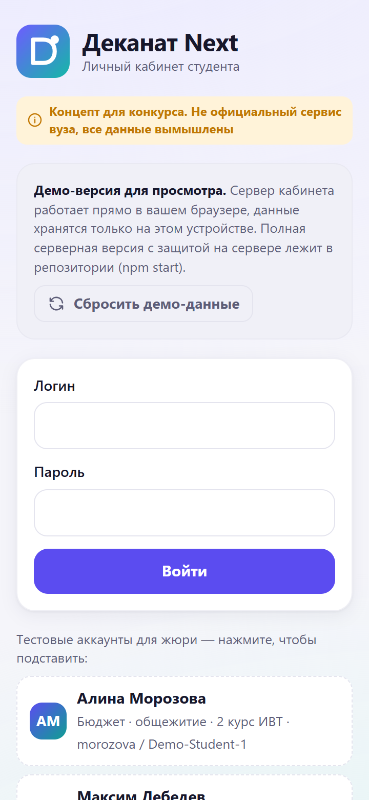 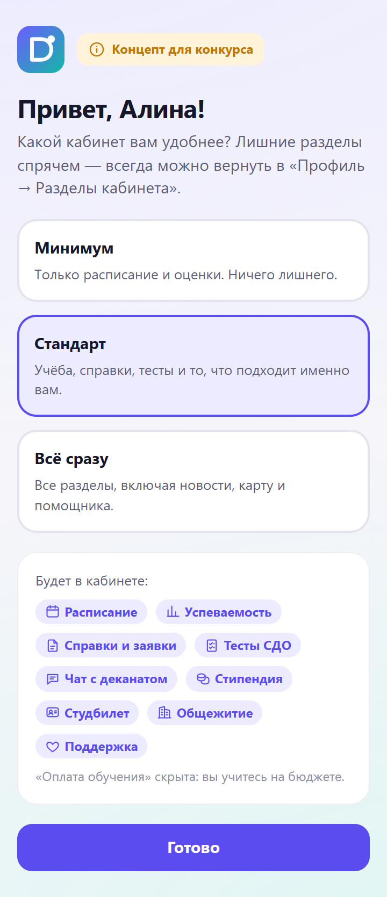 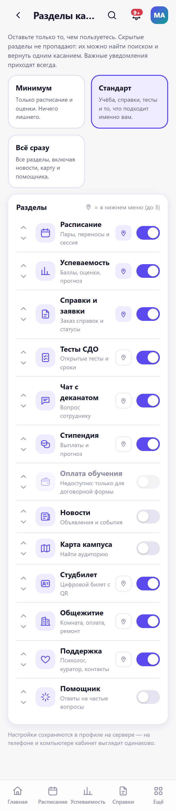

1. Вход с пометкой «концепт для конкурса» и кнопками тестовых аккаунтов.
2. Онбординг: студент выбирает набор «Минимум», «Стандарт» или «Всё».
3. Разделы кабинета: скрыть, поменять местами, закрепить в нижнем меню.

**Главная: что важно сейчас**

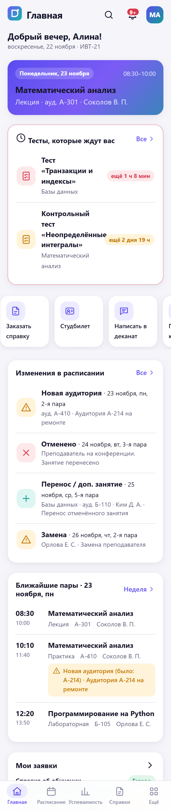 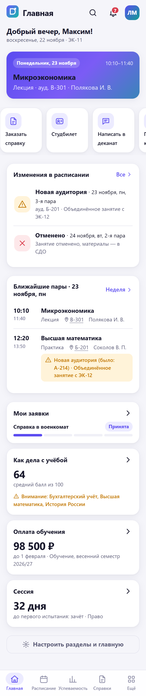

4. Алина (бюджет): следующая пара, тесты СДО с таймером, изменения в расписании.
5. Максим (контракт): вместо стипендии — оплата обучения, предупреждение о рисках по предметам.

**Расписание, оценки, тесты, календарь**

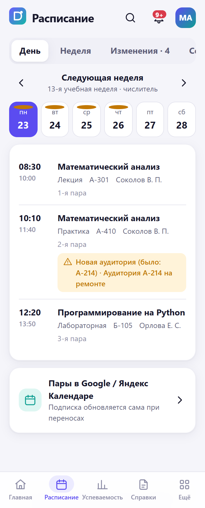 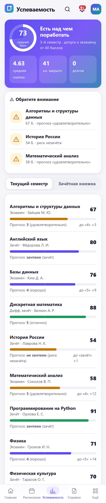 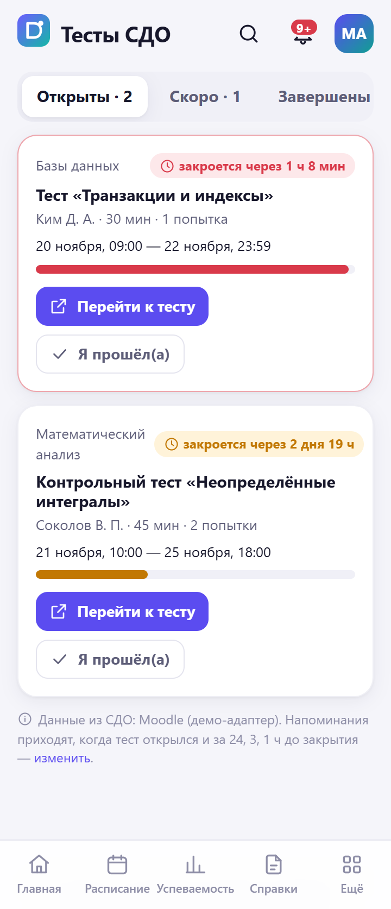 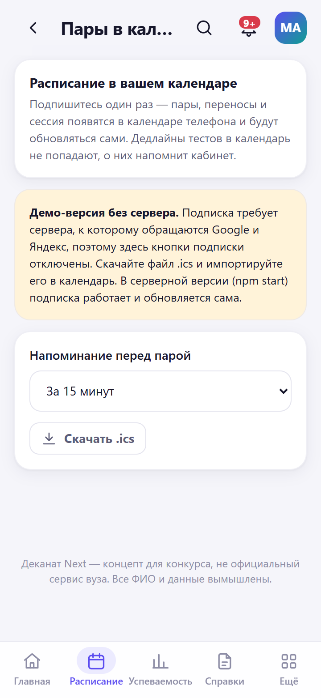

6. Расписание: переносы, отмены и замены выделены цветом.
7. Успеваемость: баллы, прогноз оценки, сколько не хватает до следующей.
8. Открытые тесты СДО со ссылками и временем до закрытия.
9. Экспорт расписания в календарь (только занятия и сессия, без дедлайнов).

**Справка: от заказа до уведомления**

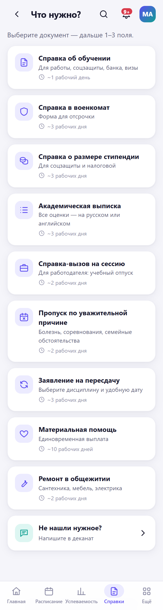 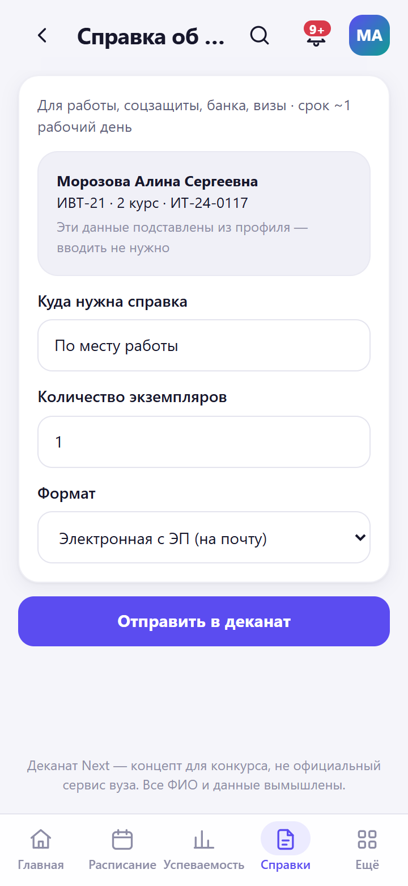 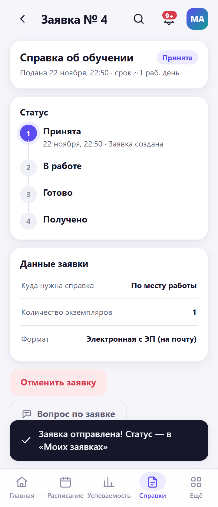 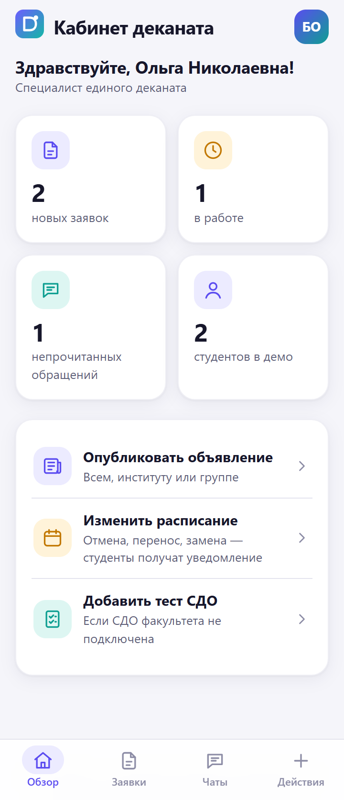 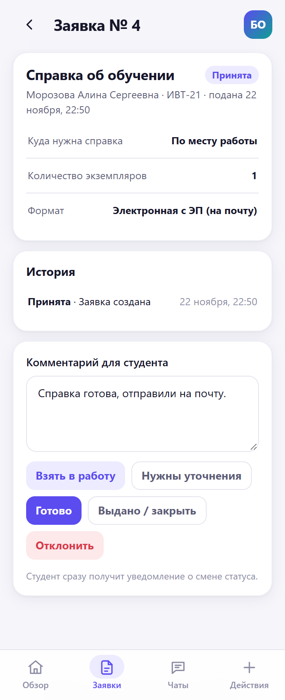 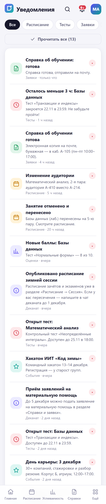

10. Студентка выбирает вид справки.
11. Форма из нескольких полей: ФИО и группа подставляются сами.
12. Заявка принята, виден трекер статуса.
13. Кабинет сотрудника деканата.
14. Сотрудник пишет комментарий и нажимает «Готово».
15. У студентки первым идёт уведомление «Справка об обучении: готова».

**Цифровой студбилет**

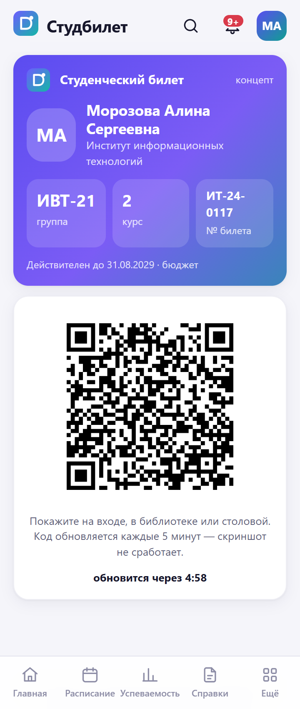

16. QR подписан и действует 5 минут, поэтому скриншот билета не пройдёт проверку.
